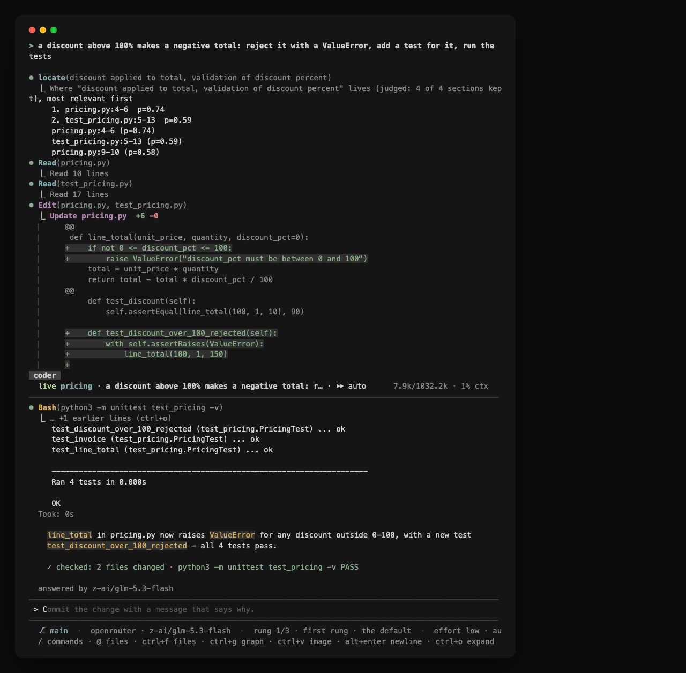

<div align="center">
  
  <h1>Memdoor</h1>
  <p><strong>Your daemon agents on every door.</strong><br>A lightweight coding and automation agent in a single CLI binary. Run it locally or connect over SSH to another machine — no Docker or Python required. Work interactively from a terminal, your IDE or phone, or start a run from a shell script, CI or a schedule and finish it from any of those, on a gateway you own, using your own key.</p>
  <p>One binary to deploy. A headless-first CLI. Multi-step jobs kept as files in your repo, with checks, approval gates and resume. Less of your token bill, through a decision model in front of the chat model.</p>
  <p>
    <a href="LICENSE"></a>
    <a href="https://github.com/guregodevo/memdoor/actions/workflows/lint.yml"></a>
    <a href="https://github.com/guregodevo/memdoor/actions/workflows/installers.yml"></a>
    
    
  </p>
</div>

On this machine:

```bash
curl -fsSL https://memdoor.ai/install.sh | bash
export OPEN_ROUTER_API_KEY=sk-or-...   # or ANTHROPIC_API_KEY, OPENAI_API_KEY, GEMINI_API_KEY, …
cd your-project && memdoor             # the first run sets the machine up
```

Or on a box you can ssh to, with nothing installed there:

```bash
curl -fsSL https://memdoor.ai/install.sh | bash          # here, once
memdoor --gateway ssh://you@box                           # installs memdoor on the box, starts its gateway, opens the window on it
memdoor --gateway ssh://you@box connect openrouter        # your key, kept on the box; every turn there runs on it
memdoor --gateway ssh://you@box run "fix the failing test" # the same box from a script or CI
```

The runs live on the box: close the laptop, the work goes on, and your phone or the next terminal opens the same conversation there.

No account. Telemetry off unless you turn it on. macOS, Linux, Windows, one static binary, Apache 2.0.

### In GitHub Actions

One step in a workflow, on your key, with nothing to add to your repo
([Marketplace](https://github.com/marketplace/actions/memdoor)):

```yaml
on: pull_request
jobs:
  review:
    runs-on: ubuntu-latest
    steps:
      - uses: actions/checkout@v5
      - uses: guregodevo/memdoor-action@v1
        with:
          workflow: pr-review
          openrouter-api-key: ${{ secrets.OPEN_ROUTER_API_KEY }}
```

Nine are built in:

- **`pr-triage`** sorts a pull request for a maintainer: ready for review, needs work, or likely slop, from checks run in the job (the tests, claimed tests that are not there, functions nothing calls).
- **`pr-review`** reviews the pull request, verifies each finding by running the code, and fails the job only on a blocker.
- **`security-review`** does the same for security only: secrets, injection, path traversal, missing authorization.
- **`write-tests`** writes tests for what the change touches, and fails the job when one shows the change is wrong.
- **`pr-description`** writes the description: title, What, Why, How to test, Risk.
- **`explain-failure`** reads a failed run's logs and the diff: the cause, file:line, and the fix.
- **`issue-triage`** suggests labels, the kind, a summary and duplicates for a new issue.
- **`fix-tests`** finds the test command, fixes the code until the tests pass, and leaves the fix in the working tree.
- **`release-notes`** turns the commits since the last tag into Added / Changed / Fixed.

No key at all: `local-model: Qwen3-8B-4bit` instead of the key runs any of them
on a model inside the runner ([janis](https://github.com/guregodevo/janis), one
file, the model cached), in one model call. It is a free first pass, not a
reviewer: on a free runner it caught an obvious and a subtle bug in about a
minute each, and can file a correct change's own fix as a blocker.

Or `workflow: <name>` for your own, `.memdoor/workflows/<name>/` in the repo. The
job ends with the run's outcome (0 done, 2 failed, 1 stopped, 3 stopped at an
approval gate) and its summary shows the review, the fix or the notes. Trigger on
`pull_request`, never `pull_request_target`: GitHub gives a fork's pull request no
secrets, so a stranger's code never runs beside your key.

On a ChatGPT Plus or Pro plan? Skip the key: `memdoor connect chatgpt` (or
`/connect chatgpt` in the window) opens Sign in with ChatGPT, and your plan's
allowance answers Memdoor's turns. A Claude subscription cannot be used this
way (Anthropic's terms); Claude needs an API key.

No money on a key yet? A free OpenRouter account and `/model
nvidia/nemotron-3-super-120b-a12b:free` run a real session: 50 requests a day,
and the free hosts train on what they are sent, so a trial, not private code.
Or no key at all: `memdoor connect local` finds a model running on this machine
([janis](https://github.com/guregodevo/janis), Ollama, llama.cpp, LM Studio),
and nothing leaves it. janis is ours: one Go server that runs the open models on
a Mac's GPU through MLX or on an NVIDIA box through CUDA, serves chat and the
decision model with no key, and runs Qwen3-Coder-30B-A3B on a $0.71-an-hour
Google L4; `memdoor --gateway ssh://you@box connect local` makes that box yours.
And that box answers your laptop: `memdoor peers add box http://box:18789 --dir
~/app` names it, and `@box:coder …` in any conversation here runs the turn there,
on the box's own model, and brings the answer back. Recorded on memdoor.ai: a
laptop with no GPU asks, Qwen3.8-27B on an L4 through janis reads, patches and
runs a Go program on the box, the window on the laptop shows it land.

<p align="center"></p>

Every run is a conversation on a gateway on your machine, whatever door it
came in by: a terminal window, `memdoor run` from a script or CI, a cron
schedule, your editor, or the page on your phone. The run a CI job started is
the one you open with `memdoor resume <id>`, watch live, and answer. One
gateway, every door ([the walk through them, with exit
codes](https://memdoor.ai/docs/headless)).

```bash
memdoor run "fix the failing test"        # one turn, no window; the exit code is the receipt of its checks
memdoor workflow run release --wait       # a workflow from a shell or CI, exit code the run's outcome
memdoor resume --last                     # the same run, in a window
```

---

`memdoor` reads your files, writes patches, runs the build and fixes what
it broke, in the directory you launch it from. Every model call goes from your
machine to the provider you connected, on your account, at their list price.

Two more things set it apart.

**A decision model in front of the chat model.** Jev (TypeSafe) answers a
typed question such as *is this hit relevant to the task?* with a calibrated
probability in under half a second, and the harness acts on it: search, file
and log reads return only what counts; only the tools the turn needs are sent;
a turn that stops making progress ends instead of looping to a cap. Measured
over 44 paired runs, decisions off and on: 22 of 22 passed each way; a question
about the codebase went from 54,661 to 14,367 input tokens (−74%); an edit with
a test and ten one-file fixes read the same files either way (within ±11%)
([`docs/features/DECIDE.md`](docs/features/DECIDE.md)).

**Workflows.** Say the steps and the coder writes them as task files, one YAML
per step, run as a graph by [`mario`](https://github.com/guregodevo/mario).
Independent steps run in parallel; a step is done when its check passes, never
because the model says so; a gate waits for your approval with the diff in
front of you; a failed run resumes at the failed step. The files live in your repo, so a workflow is kept, shared and
run again, by hand or on your local cron
([`docs/features/WORKFLOWS.md`](docs/features/WORKFLOWS.md)). Why workflows
rather than skills: [the write-up](https://guregodevo.github.io/2026/10/06/workflows-not-skills/).
Worked examples, each run before it was added: [`examples/workflows/`](examples/workflows/).
One of them, the step that grades a trading rule (`examples/workflows/nightly-rule/steps/grade.yaml`), as it runs nightly; no code in it:

```yaml
type: agent
prompt: |
  Today's partition is {{.partition}}.
  Read rules/{{.partition}}.md and grade today's trading rule: assess it
  briefly (clarity, risk profile, plausibility) and write a JSON object
  {"score": <0-100 integer>, "verdict": "<one sentence>"} into
  grades/{{.partition}}.json (create grades/ if needed).
requires:
  - table_pattern: build
target:
  # run by the engine, not by the agent: the grade must exist and be newer than step 1's start stamp
  command: test "grades/{{.partition}}.json" -nt "rules/{{.partition}}.start" && test -s "grades/{{.partition}}.json"
timeout: 10m
```

A recorded session of the review loop (findings verified by running, a gate,
the fixes applied) plays at [memdoor.ai/workflows](https://memdoor.ai/workflows).

## Install

```bash
curl -fsSL https://memdoor.ai/install.sh | bash
export OPEN_ROUTER_API_KEY=sk-or-...   # or ANTHROPIC_API_KEY, OPENAI_API_KEY, GEMINI_API_KEY, … or /connect inside
cd your-project && memdoor             # the first run sets the machine up
```

macOS (Apple Silicon and Intel), Linux (amd64, arm64; static), Windows
(`irm https://memdoor.ai/install.ps1 | iex`; the agent runs commands in
Git Bash when it is installed, otherwise PowerShell). One binary, installed to
`~/.local/bin`, no sudo, no Docker, no Python. The installer
([`scripts/install.sh`](scripts/install.sh)) verifies the SHA-256 of what it
downloads.

From a clone, with Go 1.25:

```bash
git clone https://github.com/guregodevo/memdoor && cd memdoor
make build                             # ./memdoor, stamped with the tag it was built from
cp memdoor ~/.local/bin/               # or anywhere on your PATH
```

## In the window

| Command | What it does |
|---|---|
| `/model` | Which model answers: the agent's ladder (cheapest rung first), or pin any model of your providers, with list prices |
| `/connect` | Add a provider: OpenRouter, Anthropic, OpenAI, Gemini, DeepSeek, Baseten, Groq, xAI, any OpenAI-compatible endpoint, your company's AI gateway; `/connect local` a runtime on this machine or the box (Ollama, llama.cpp, janis), no key; `/connect chatgpt` signs in with a ChatGPT Plus/Pro plan, no key |
| `/workflow` | The project's workflows and runs; enter opens a run's graph, `a` approves a gate, `/workflow:<name>` runs one |
| `/usage` | This month on your key, per model, and what the decision model kept out of the bill |
| `/remote` | This conversation on your phone: a link and a QR code, the terminal itself, end-to-end encrypted |
| `/remote view` | A watch-only link: whoever opens it sees the terminal live and cannot type, no account, up to 200 at once; `?live=1` is the terminal alone, for a stream or OBS |
| `/share` | A read-only link to the conversation, encrypted, secrets removed; `/unshare` deletes it |
| `/files` or `ctrl+f` | The project's files, the ones this conversation read or changed first, each with what happened to it; enter previews, `ctrl+d` diffs, `ctrl+e` opens in `$EDITOR`, tab puts `@path` in the prompt |
| `/graph` or `ctrl+g` | This turn as a graph: the reads, the edits that depended on them, the runs that depended on the edits, the failing check in red |
| `/mcp` | Connect MCP servers from a URL, a command or a `.mcp.json` snippet |
| `/help` | The rest |

`Esc` interrupts a turn, `ctrl+f` opens the files panel, `ctrl+g` the turn as a graph, `ctrl+o` expands tool
frames, `Shift+Tab` sets the reasoning effort, `@path` mentions a file. `MEMDOOR_APPROVE=changes` asks
before every command and write, for machines whose policy requires it.

## In your editor

`memdoor acp` serves the same coder over the [Agent Client Protocol](https://agentclientprotocol.com):
Zed and JetBrains host it natively; VS Code through an ACP client extension
(for example "ACP Client"), with one setting:

```json
"acp.agents": { "Memdoor": { "command": "memdoor", "args": ["acp"] } }
```

Each editor session is a conversation on your local gateway; a prompt is a
turn in the editor's workspace folder, and the turn's text, tool calls and
approvals show as the editor's own. The steps: [memdoor.ai/docs/editor](https://memdoor.ai/docs/editor).

## From a script

```bash
memdoor run "make the retry wait configurable and add a test"     # a headless turn, no window
git diff | memdoor run "review this diff; one line per finding"    # stdin is the input
memdoor run --json "fix the failing test" | jq 'select(.event=="done")'
memdoor workflow run release --wait                                 # progress on stderr, results on stdout
memdoor remote --last                                               # the link /remote gives, on stdout; the gateway holds the run for your phone
memdoor remote --view --last                                        # the watch-only link: an audience, or a pair of eyes
```

The exit code is the turn's receipt: 0 checked, 2 unverified or a failing check,
3 a question nobody answered (`--yes` answers it), 1 an error, 130 interrupted. The gateway
starts if none is running; every run is a conversation `memdoor resume` opens.
[Headless, then attached](https://memdoor.ai/docs/headless).

A workflow in GitHub Actions is one step: [In GitHub Actions](#in-github-actions) above.

## Where your data goes

Files, sessions and commands stay on your machine. What leaves is what the
model reads, sent to the provider you connected; on OpenRouter every request
carries `data_collection: deny` and hosts that train on paid inputs are kept out
of the ladders. The one exception is a model you pin whose id ends in `:free`:
its hosts train on what they are sent, the request says so (`allow`), and the
pin warns; use one for a trial, not on private code. On a vendor key or a company gateway nothing else is contacted:
[`docs/SECURITY.md`](docs/SECURITY.md) lists every host the binary can name and
a test fails the build on a new one.

## Documentation

- [Getting started](GETTING_STARTED.md)
- [Workflows](docs/features/WORKFLOWS.md) · [Scheduled checks](docs/features/cron-jobs.md) · [MCP servers](docs/features/MCP.md)
- [Providers](docs/features/PROVIDERS.md) · [Security](docs/SECURITY.md) · [Decisions](docs/features/DECIDE.md)
- [CLI reference](docs/reference/CLI.md) · [Architecture](docs/reference/ARCHITECTURE.md) · [Skills](docs/reference/SKILLS.md) · [ADRs](docs/adr/)
- The served docs: [memdoor.ai/docs](https://memdoor.ai/docs/getting-started)

## Repository layout

```
cmd/cli/       the CLI (cobra): tui, model, workflow, cron, account, …
gateway/       the local gateway: agent runtime, tools, providers, workflows
pkg/           the domain: decision, metering, plan, workflow (the mario task factory), …
web/           the memdoor.ai site and the served docs (React, Vite)
scripts/       install.sh, install.ps1, deploy.sh
docs/          features, reference, ADRs
examples/      workflows built by the coder and run, to copy into a project
```

## License

Apache License 2.0 — [LICENSE](LICENSE), [NOTICE](NOTICE). The public
repository is [github.com/guregodevo/memdoor](https://github.com/guregodevo/memdoor); issues there.
