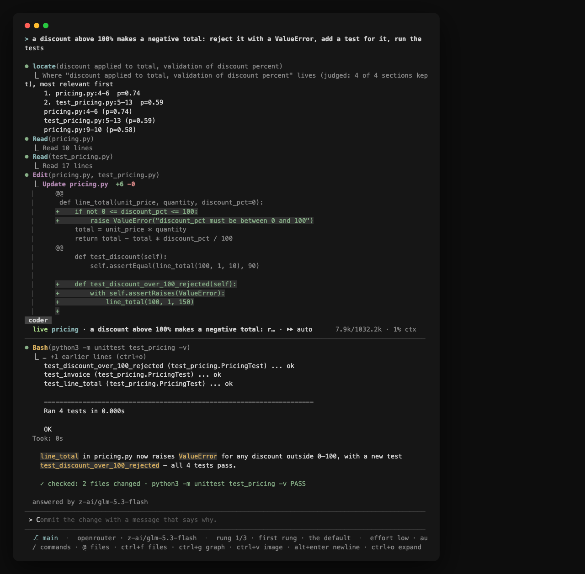

<div align="center">
  
  <h1>Memdoor</h1>
  <p><strong>Team Mode: cheap models, frontier results.</strong><br>The open coding agent in one Go binary. Press Shift+Tab and Go Team Mode. Five Qwen3.8-27B agents beat Fable 5 on LiveCodeBench Hard, every run published. Ollama, llama.cpp, or any key. No account.</p>
  <p>
    <a href="https://news.ycombinator.com/item?id=50320995"></a>
    <a href="LICENSE"></a>
    <a href="https://github.com/guregodevo/memdoor/actions/workflows/lint.yml"></a>
    <a href="https://github.com/guregodevo/memdoor/actions/workflows/installers.yml"></a>
    
    
  </p>
</div>

> **Five Qwen3.8-27B agents beat Fable 5 on LiveCodeBench Hard, as a Memdoor workflow.**
> [GVS5H](https://github.com/slee-persis/GVS5H)'s harness rebuilt with the
> authors' exact prompts and loop. The first ten problems of their list, five
> passes each: a mean of **9.8 of 10**. The authors' own harness scored 9.6 and
> Fable 5 in a single call 8.0, the gap the authors measured on these ten
> (across their full 100: 92.4 and 90.4). All 50 runs are published: every
> request, reply, program and grader output. The workflow is YAML and names no
> model. Point it at yours, or at a local one with `memdoor connect local`
> (janis, the runtime we recommend; Ollama, llama.cpp, vLLM and LM Studio
> work too; [how to run it on an open-weight model,
> no key](https://memdoor.ai/docs/open-weight)).
> [examples/workflows/team-solve](examples/workflows/team-solve/) · [the result page](https://memdoor.ai/docs/team-solve) · [the HN thread](https://news.ycombinator.com/item?id=50320995)

Memdoor is a coding agent and workflow runner. Give the agent a task to read
files, edit code and run checks. For repeatable work, a workflow coordinates
checked steps, parallel tasks and approval gates. Run it with a local model or
a provider on your key.

On this machine:

```bash
curl -fsSL https://memdoor.ai/install.sh | bash
cd your-project && memdoor             # sets the machine up, then a key, a sign-in or a local model
# no key: memdoor connect local       # janis and an open-weight model on this machine — https://memdoor.ai/docs/open-weight
memdoor cron add --workflow team-backlog "0 2 * * *"   # one open issue a night, a pull request when its Check passed
```

The install or the first run did not finish: [open an Install issue](https://github.com/guregodevo/memdoor/issues/new?template=install.md).

On a box reachable by ssh, nothing installed there:

```bash
curl -fsSL https://memdoor.ai/install.sh | bash          # here, once
memdoor --gateway ssh://you@box                           # installs memdoor on the box, starts its gateway, opens the window on it
memdoor --gateway ssh://you@box connect openrouter        # your key, kept on the box; every turn there runs on it
memdoor --gateway ssh://you@box run "fix the failing test" # the same box from a script or CI
```

<p align="center"></p>

**Decision model.** Jev (TypeSafe) answers a typed question about a turn
with a calibrated probability in under half a second. Judged reads: search,
file and log reads return what counts. Per-turn toolbox: only the tools the
turn needs are sent. Stall detection: a turn that stops making progress ends.
44 paired runs, decisions off and on: 22 of 22 passed each way; a codebase
question 54,661 to 14,367 input tokens (−74%); an edit with a test and ten
one-file fixes read the same files either way (within ±11%)
([`docs/features/DECIDE.md`](docs/features/DECIDE.md)).

**Workflows, the deterministic harness.** Say the steps; the coder writes one
YAML per step. [`mario`](https://github.com/guregodevo/mario) runs the graph.
Independent steps run in parallel. A step is done when its check passes. A
gate waits for approval with the diff. A failed run resumes at the failed
step. Started by hand, from CI or on local cron
([`docs/features/WORKFLOWS.md`](docs/features/WORKFLOWS.md)). Workflows, not
skills: [the write-up](https://guregodevo.github.io/2026/10/06/workflows-not-skills/).
Examples, each run before it was added:
[`examples/workflows/`](examples/workflows/). The nightly grade step,
`examples/workflows/nightly-rule/steps/grade.yaml`:

```yaml
type: agent
prompt: |
  Today's partition is {{.partition}}.
  Read rules/{{.partition}}.md and grade today's trading rule: assess it
  briefly (clarity, risk profile, plausibility) and write a JSON object
  {"score": <0-100 integer>, "verdict": "<one sentence>"} into
  grades/{{.partition}}.json (create grades/ if needed).
requires:
  - table_pattern: build
target:
  # run by the engine, not by the agent: the grade must exist and be newer than step 1's start stamp
  command: test "grades/{{.partition}}.json" -nt "rules/{{.partition}}.start" && test -s "grades/{{.partition}}.json"
timeout: 10m
```

The review loop recorded (findings verified by running, a gate, the fixes
applied): [memdoor.ai/workflows](https://memdoor.ai/workflows).

## In the window

| Command | What it does |
|---|---|
| `/model` | The agent's ladder, cheapest rung first. Pin any model of your providers. List prices |
| `/connect` | Add a provider: OpenRouter, Anthropic, OpenAI, Gemini, DeepSeek, Baseten, Groq, xAI, any OpenAI-compatible endpoint, a company AI gateway. `/connect local`: janis on this machine or the box, or Ollama, llama.cpp, LM Studio, vLLM; no key. `/connect chatgpt`: a ChatGPT Plus/Pro plan, no key |
| `/w` | The project's workflows and runs. `/w <name> [the task]` runs one (`/w team-solve <the task>`), enter opens a run's graph, `a` approves a gate |
| `/usage` | This month on your key, per model, and what the decision model kept out of the bill |
| `/remote` | This conversation on your phone: a link and a QR code, the terminal itself, end-to-end encrypted |
| `/remote view` | A watch-only link: live, no typing, no account, up to 200 viewers. `?live=1` is the terminal alone, for a stream or OBS |
| `/files` or `ctrl+f` | The project's files, the ones this conversation read or changed first, each with what happened to it. Enter previews, `ctrl+d` diffs, `ctrl+e` opens in `$EDITOR`, tab puts `@path` in the prompt |
| `/graph` or `ctrl+g` | The turn as a graph: the reads, the edits that depended on them, the runs that depended on the edits, the failing check in red |
| `/mcp` | MCP servers from a URL, a command or a `.mcp.json` snippet |
| `/help` | The rest |

`Esc` interrupts. `ctrl+o` expands tool frames. `Shift+Tab` switches the mode,
auto or team. `ctrl+t` sets the reasoning effort. `@path` mentions a file. `MEMDOOR_APPROVE=changes` asks before every
command and write.

## In your editor

`memdoor acp` serves the coder over the [Agent Client
Protocol](https://agentclientprotocol.com). Zed and JetBrains host it
natively. VS Code: an ACP client extension (for example "ACP Client") and one
setting:

```json
"acp.agents": { "Memdoor": { "command": "memdoor", "args": ["acp"] } }
```

A session is a conversation on the local gateway. A prompt is a turn in the
editor's workspace folder. Text, tool calls and approvals show as the
editor's own. Steps: [memdoor.ai/docs/editor](https://memdoor.ai/docs/editor).

## From a script

```bash
memdoor run "make the retry wait configurable and add a test"     # a headless turn, no window
git diff | memdoor run --stdin "review this diff; one line per finding"    # --stdin: stdin is the input
memdoor run --json "fix the failing test" | jq 'select(.event=="done")'
memdoor workflow run release --wait                                 # progress on stderr, results on stdout
memdoor remote --last                                               # the link /remote gives, on stdout; the gateway holds the run for your phone
memdoor remote --view --last                                        # the watch-only link: an audience, or a pair of eyes
```

Exit code: 0 checked, 2 unverified or a failing check, 3 a question nobody
answered (`--yes` answers it), 1 an error, 130 interrupted. The gateway starts
if none is running. `memdoor resume` opens any run.
[Headless, then attached](https://memdoor.ai/docs/headless).

## In GitHub Actions

One step. Your key as the secret. Nothing added to the repo
([Marketplace](https://github.com/marketplace/actions/memdoor)):

```yaml
on: pull_request
jobs:
  review:
    runs-on: ubuntu-latest
    steps:
      - uses: actions/checkout@v5
      - uses: guregodevo/memdoor-action@v1
        with:
          workflow: pr-review
          openrouter-api-key: ${{ secrets.OPEN_ROUTER_API_KEY }}
```

Built in:

- **`pr-triage`**: ready for review, needs work, or likely slop, from checks run in the job (the tests, claimed tests that are not there, functions nothing calls).
- **`pr-review`**: findings verified by running the code; the job fails only on a blocker.
- **`security-review`**: secrets, injection, path traversal, missing authorization.
- **`write-tests`**: tests for what the change touches; the job fails when one shows the change is wrong.
- **`pr-description`**: title, What, Why, How to test, Risk.
- **`explain-failure`**: a failed run's logs and the diff; the cause, file:line, the fix.
- **`issue-triage`**: labels, kind, summary, duplicates.
- **`fix-tests`**: finds the test command, fixes the code until the tests pass, leaves the fix in the working tree.
- **`release-notes`**: commits since the last tag as Added / Changed / Fixed.
- **`team-solve`**: the task a prompt defines (`memdoor workflow run team-solve "<the task>"`), done by a team of fresh contexts, GVS5H's method on any task and any model: changes across a repository checked by its own tests, a program by its samples, a document by a fresh judge. Its prompts differ from the published steps', so the 9.8 above is theirs, not the built-in's.
- **`team-backlog`**: the repository's open issues, unattended: the next issue nobody is on, team-solve on it in a branch, a pull request when the Check passed, a comment on the issue when it did not; one issue a run, on a cron (`memdoor cron add --workflow team-backlog "0 2 * * *"`).

`local-model: Qwen3-8B-4bit` in place of the key: the model runs inside the
runner ([janis](https://github.com/guregodevo/janis), one file, cached), one
call. On a free runner: an obvious and a subtle bug found in about a minute
each; a correct change can be flagged as a blocker. A first pass.

`workflow: <name>` runs yours from `.memdoor/workflows/<name>/`. Exit code:
0 done, 2 failed, 1 stopped, 3 stopped at an approval gate. The job summary
holds the review, the fix or the notes. Trigger on `pull_request`, never
`pull_request_target`: a fork's pull request gets no secrets.

## Keys and models

A provider key in the environment (`OPENROUTER_API_KEY`, `ANTHROPIC_API_KEY`,
`OPENAI_API_KEY`, `GEMINI_API_KEY`, …) or `memdoor connect`. No key: the
first `memdoor` signs in with OpenRouter in the browser, from this machine,
over ssh or on a box. No credit: a free model, 50 requests a day; its hosts
train on what they are sent. For a trial, not private code.

Local: `memdoor connect local` installs [janis](https://github.com/guregodevo/janis),
the runtime we recommend, or connects a running Ollama, llama.cpp or LM Studio.
Nothing leaves it. janis: one Go server, open models on a Mac's GPU through
MLX or an NVIDIA box through CUDA, serves chat and the decision model, no
key; Qwen3-Coder-30B-A3B on a $0.71-an-hour Google L4. On a box: `memdoor
--gateway ssh://you@box connect local`. Peers: `memdoor peers add box
http://box:18789 --dir ~/app` names the box; `@box:coder …` in any
conversation runs the turn there and returns the answer.

## Where your data goes

Files, sessions and commands stay on your machine. What the model reads goes
to the provider. OpenRouter: every request carries `data_collection: deny`;
hosts that train on paid inputs are kept out of the ladders. Exception: a
`:free` model, pinned or answering for an account with no credit; its hosts
train on what they are sent, the request says so (`allow`), Memdoor warns at
the pin or at connect. Vendor key or company gateway: nothing else is
contacted. [`docs/SECURITY.md`](docs/SECURITY.md) lists the hosts the binary
can name; a test fails the build on a new one.

## Install from a GitHub release

Every release on GitHub carries the binaries and `SHA256SUMS`. To install from
there instead of memdoor.ai, or from a fork that publishes its own:

```bash
curl -fsSL https://github.com/guregodevo/memdoor/raw/main/scripts/install.sh \
  | MEMDOOR_INSTALL_SOURCE=github bash
# a fork, a fixed release: MEMDOOR_GITHUB_REPOSITORY=owner/repo MEMDOOR_GITHUB_RELEASE=v1.2.3
```

Keep `MEMDOOR_INSTALL_SOURCE=github` in the environment and `memdoor upgrade`
reads the same source.

## Build from source

Go 1.25:

```bash
git clone https://github.com/guregodevo/memdoor && cd memdoor
make install                           # builds ./memdoor, then installs it as install.sh does
```

## Documentation

- [Getting started](GETTING_STARTED.md)
- [Workflows](docs/features/WORKFLOWS.md) · [Scheduled checks](docs/features/cron-jobs.md) · [MCP servers](docs/features/MCP.md)
- [Providers](docs/features/PROVIDERS.md) · [Security](docs/SECURITY.md) · [Decisions](docs/features/DECIDE.md)
- [CLI reference](docs/reference/CLI.md) · [Architecture](docs/reference/ARCHITECTURE.md) · [Skills](docs/reference/SKILLS.md) · [ADRs](docs/adr/)
- The served docs: [memdoor.ai/docs](https://memdoor.ai/docs/getting-started)

## Repository layout

```
cmd/cli/       the CLI (cobra): tui, model, workflow, cron, account, …
gateway/       the local gateway: agent runtime, tools, providers, workflows
pkg/           the domain: decision, metering, plan, workflow (the mario task factory), …
web/           the memdoor.ai site and the served docs (React, Vite)
scripts/       install.sh, install.ps1, deploy.sh
docs/          features, reference, ADRs
examples/      workflows built by the coder and run, to copy into a project
```

## License

Apache License 2.0: [LICENSE](LICENSE), [NOTICE](NOTICE). Public repository:
[github.com/guregodevo/memdoor](https://github.com/guregodevo/memdoor). Issues
go there.
